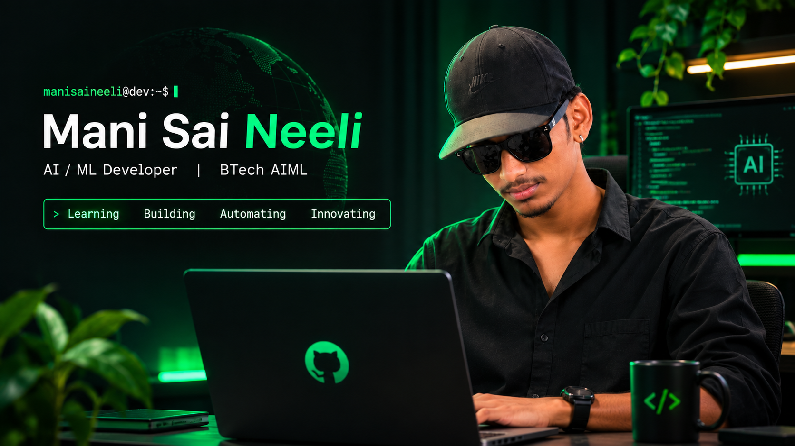

<div align="center">



<br/>


<p>
  <a href="https://github.com/manisaineeli">
    
  </a>
  
  
</p>

</div>

---

<table>
<tr>
<td width="55%" valign="top">

### `> whoami`

I'm a B.Tech student specialising in **Artificial Intelligence and Machine Learning**.

- Exploring Machine Learning and Deep Learning.
- Interested in Generative AI and LLMs.
- Building practical software projects.
- Improving my programming and problem-solving skills.
- Open to internships and collaborations.

</td>
<td width="45%" valign="top">

### `> current_focus`

```python
focus = [
    "Artificial Intelligence",
    "Machine Learning",
    "Generative AI",
    "LLMs",
    "NLP",
    "Computer Vision"
]

mindset = "Learn. Build. Improve."
```

</td>
</tr>
</table>

## `01 / TECH STACK`

<div align="center">

**Languages**


**AI / ML & Data**


**Development & Tools**


</div>

## `02 / FEATURED PROJECTS`

<table>
<tr>
<td width="50%" valign="top">

<h3>◈ FemCare</h3>

A privacy-conscious menstrual health companion focused on cycle tracking, awareness and personal guidance.

**Stack**

`React` `Vite` `Tailwind CSS`

<a href="https://github.com/manisaineeli/Femcare">
  
</a>

<a href="https://manisaineeli.github.io/Femcare/">
  
</a>

</td>
<td width="50%" valign="top">

<h3>◈ ML Programs</h3>

A practical collection of machine-learning exercises covering algorithms, preprocessing, data analysis and introductory NLP.

**Stack**

`Python` `NumPy` `Pandas` `Scikit-learn`

<a href="https://github.com/manisaineeli/ML_PROGRAMS">
  
</a>

</td>
</tr>
<tr>
<td width="50%" valign="top">

<h3>◈ CommBank Goal Tracker</h3>

A web development project exploring a goal-tracking interface and frontend implementation.

**Focus**

`Web Development` `UI` `Frontend`

<a href="https://github.com/manisaineeli/CommBank-Web">
  
</a>

</td>
<td width="50%" valign="top">

<h3>◈ More Experiments</h3>

Exploring ideas in AI, automation and software development.

**Interests**

`LLMs` `Generative AI` `Automation`

<a href="https://github.com/manisaineeli?tab=repositories">
  
</a>

</td>
</tr>
</table>

## `03 / GITHUB ANALYTICS`

<div align="center">

<a href="https://github.com/manisaineeli">
  
</a>
<a href="https://github.com/manisaineeli">
  
</a>

<br/>


</div>

## `04 / CONTRIBUTION ACTIVITY`

<div align="center">

<picture>
  <source media="(prefers-color-scheme: dark)" srcset="https://raw.githubusercontent.com/manisaineeli/manisaineeli/output/github-snake-dark.svg">
  
</picture>

</div>

## `05 / CONNECT`

<div align="center">

<a href="https://github.com/manisaineeli">
  
</a>
<a href="https://github.com/manisaineeli?tab=repositories">
  
</a>

<br/><br/>

<code>while (learning) { build(); experiment(); improve(); }</code>

<br/><br/>

<sub>Designed with curiosity · Built with consistency</sub>

</div>
